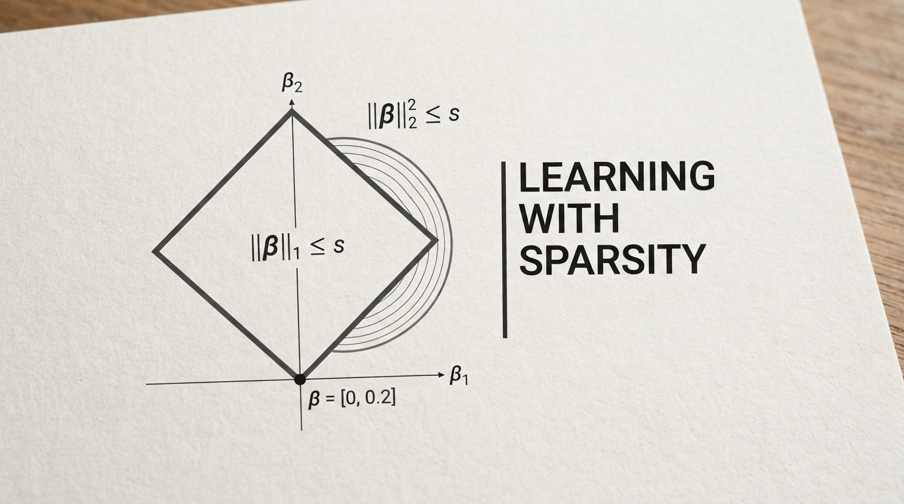

Earlier this year I got my hands on a copy of *Statistical Learning with Sparsity* by Hastie, Tibshirani & Wainwright, and I am happy to say this is one of the best technical books I've read in a long time. Sparsity is an idea that has remained surprisingly current in ML and AI for decades, and the book is superbly written. It also illustrates, from first principles, several interesting applications of sparsity I didn't know. Below are some of the ideas I found most interesting from it.

# Sparsity from first principles (⚠️ Algebra ahead) {#sec-first-principles}

Fitting an ML model is, at its core, all about solving a numerical optimisation problem. Say we have data $\mathbf{X}, \mathbf{y}$, a supervised model $f(\cdot; \theta)$ parametrised by $\mathbf{\theta}$ and a loss function $\mathcal{L}$. Under this framework, the fitted model is represented by the fitted parameters $\mathbf{\theta}^*$, defined as

$$
\mathbf{\theta}^* = \argmin_{\mathbf{\theta}} \mathcal{L}(\mathbf{y}, f(\mathbf{X}; \mathbf{\theta}))
$$ {#eq-erm}

We may suspect the model is overparametrised, or perhaps we are just interested in the parameters with the largest effects, so we want to sparsify the solution $\mathbf{\theta}^*$. We measure sparsity by counting the number of parameters that aren't zero in the fitted model. Define the L0 norm $||\cdot||_0$ as the count of non-zero elements in a vector. Then, we have several interrelated ways of incorporating sparsity into the formulation above. We could ask for at most $k$ parameters being non-zero

$$
\mathbf{\theta}^* = \argmin_{\mathbf{\theta}} \mathcal{L}(\mathbf{y}, f(\mathbf{X}; \mathbf{\theta})) \quad \text{s.t.} \quad ||\mathbf{\theta}||_0 \leq k
$$ {#eq-l0-constrained}

Or we could minimise the number of active parameters subject to an acceptable training error

$$
\mathbf{\theta}^* = \argmin_{\mathbf{\theta}} ||\mathbf{\theta}||_0 \quad \text{s.t.} \quad \mathcal{L}(\mathbf{y}, f(\mathbf{X}; \mathbf{\theta})) \leq \lambda, \quad \lambda \geq 0
$$ {#eq-l0-error-constrained}

Or we could simply add a penalty to the number of active parameters to encourage sparse solutions

$$
\mathbf{\theta}^* = \argmin_{\mathbf{\theta}} \mathcal{L}(\mathbf{y}, f(\mathbf{X}; \mathbf{\theta})) + \lambda ||\mathbf{\theta}||_0, \quad \lambda \geq 0
$$ {#eq-l0-penalized}

The problem with the above formulations lies in the fact that optimising an L0 norm is a combinatorial NP-hard problem. But there is one trick from numerical optimisation we can use: convex relaxation. If we think of the L0 norm as the limit 

$$
||x||_0 = \lim_{p \to 0} ||x||_p^p 
$$ {#eq-l0-limit}

where $||\cdot||_p$ is [Minkowski's p-norm](https://en.wikipedia.org/wiki/Lp_space#The_p-norm_in_finite_dimensions), then the convex relaxation of the L0 norm is the L1 norm

$$
||x||_1 = \sum_{i=1}^n |x_i|
$$ {#eq-l1-norm}

Inducing sparsity through the L1 norm is a computationally tractable alternative to optimising for true sparsity $||x||_0$, and indeed if we replace the L0 norm with the L1 norm in the above optimisation problems, we obtain many of the classic sparse learning algorithms! For example, @eq-l0-penalized is the one being used in deep learning and other differentiable models, while @eq-l0-error-constrained is the formulation for [basis pursuit denoising](https://en.wikipedia.org/wiki/Basis_pursuit_denoising). L1 regularisation does not always recover the same solution as L0, but it is often a useful proxy.

# Some interesting sparse models

## Matrix completion

For me, a highlight of the book was the chapter on sparse matrix decompositions, and particularly their formulation for matrix completion.

Suppose you have a matrix $\mathbf{X}$ with unobserved entries. This could be the case, for example, in a recommendation system where rows are users and columns are items, and you only ever observe a tiny subset of the universe of (user, item) ratings. It could also be the case that your data has missing values, and you are interested in imputing them.

One of the most venerable matrix decomposition methods out there is the [SVD](https://en.wikipedia.org/wiki/Singular_value_decomposition), which happens to produce the best rank-k approximation of a matrix measured by the elementwise squared errors:

$$
\text{SVD}(\mathbf{X}) = U_k \Sigma_k V^{T}_k = \argmin_{U, \Sigma, V} ||\mathbf{X} - U \Sigma V^T ||_F^2 \quad \text{s.t.} \quad \text{rank}(U \Sigma V^T) \leq k
$$

Intuitively speaking, low-rank approximation models will try to find a small number of relationships that explain most of the data. Using these relationships to interpolate unobserved entries sounds like a good idea. However, the optimality guarantees from the SVD do not apply to partially observed matrices, and numerical optimisation directly on a rank constraint is computationally infeasible. Instead, they suggest using the nuclear norm, which is defined as the sum of a matrix's singular values, as a convex relaxation of the rank constraint. Let $||\cdot||_*$ be the nuclear norm operator, and let $\Omega$ be the set of observed entries $(i, j)$ in $\mathbf{X}$. The authors propose fitting a complete matrix $\hat{\mathbf{X}}$ through the following optimisation problem
$$
\hat{\mathbf{X}} = \argmin_{\mathbf{M}} \frac{1}{2} \sum_{(i,j) \in \Omega} (x_{i,j} - m_{i,j})^2 + \lambda ||\mathbf{M}||_*, \quad \lambda > 0
$$

The penalty encourages the solution to be low rank, and because both terms are convex, the solution is a global optimum. Larger values of $\lambda$ favour simpler, lower-rank matrices, at the cost of fitting the observed entries less closely. In @mazumder2010spectral, the authors also propose a solver based on iterative SVD decompositions, so this model is quite practical to implement as well. 

## Clustering

Clustering was one place where I didn't expect to find sparse models, as in my experience sparsity is more commonly associated with supervised learning. In @hastie2015statistical the authors propose a variation of [hierarchical clustering](https://en.wikipedia.org/wiki/Hierarchical_clustering) that incorporates a measure of sparsity. They define a feature weight vector $w$ and incorporate it in distance computations, constraining $||w||_1$ so that in the end only a subset of features retain nonzero weights. The objective is then to recover most of the variability in the distance matrix $\mathbf{D}$. Intuitively, this process would shrink the weights of redundant, constant, or noisy features to zero, leaving features that encapsulate most of the difference between data points. 

The optimisation problem they propose is 

$$
\max_{u, w} u^T\mathbf{\Delta}w \quad \text{s.t.} \quad ||u||_2 \leq 1, \quad ||w||_2 \leq 1, \quad ||w||_1 \leq s, \quad w \geq 0
$$

where $\mathbf{\Delta}$ is an "unrolled" version of $\mathbf{D}$ and has shape $n^2 \times p$, where $n$ is the sample size and $p$ the data dimensionality. Each row represent a pair of points and each column represents a feature. Note $u$ is a nuisance variable here and it is discarded once the optimal $w$ is found, but $u$ is necessary to keep the optimisation problem bilinear, and hence easily solvable.

Arguably, this model was formulated thinking of applications such as genomics where $n$ is small and $p$ is large. For most applications the opposite happens, and the computation of the objective function can become a problem due to the size of $\mathbf{\Delta}$. While there are some tricks that keep this problem manageable for Euclidean distance for large $n$, using other metrics in the distance matrix $\mathbf{D}$, such as L1 norm, can make this a challenging numerical problem.

Full details are available in @witten2010framework.

## Dictionary learning

The book speaks briefly about signal processing models, and how sparsity can be used to compress complex signals. A common approach to decompose a signal is representing it in a standard vector space, such as a Fourier space where canonical vectors are sinusoidal functions. But a signal will rarely have a sparse Fourier representation. However, we can combine two ideas here: the first is using an overcomplete basis, say, the union of a Fourier basis and a [Haar wavelet](https://en.wikipedia.org/wiki/Haar_wavelet) basis. This overcomplete basis is not orthogonal or linearly independent anymore, but this is where the second idea, sparsity, comes in: by encouraging a sparse representation of the original signal in the overcomplete basis (using any of the formulations in the [first section](#sec-first-principles)), we can usually get better compression. For example, a signal containing both smooth oscillations and abrupt changes may need many coefficients in either basis alone, but only a few sinusoids and wavelets together. Implementations of this idea are usually referenced as [dictionary learning](https://en.wikipedia.org/wiki/Sparse_dictionary_learning).

# References

